# dot application of Surfaces

This is the approved UI implementation target, not a claim that the native apps already implement it.
The static reference images specify composition and geometry; [Color bindings](#color-bindings) specifies the colors.
Identity squares and gradient preview surrounds are presentation placeholders, not final product artwork or
application surfaces.

[DESIGN.md](DESIGN.md) owns the rules, metrics, profiles, reference palette, and change-control policy.
This guide defines dot's product-specific composition, chrome palette, and native bindings for both themes.
Use the canonical tokens rather than introducing component-specific values.

## Applicable rules

| Surface | Normative rules |
|---------|-----------------|
| Android app | [Android touch profile](DESIGN.md#101-android-touch-profile) and [opaque chrome profile](DESIGN.md#102-opaque-chrome-profile) |
| Desktop chat | [Shared metrics](DESIGN.md#4-metrics), [opaque chrome profile](DESIGN.md#102-opaque-chrome-profile), and [chat text alignment](DESIGN.md#103-desktop-chat-text-alignment) |
| Desktop editor | [Shared metrics](DESIGN.md#4-metrics), [component catalogue](DESIGN.md#9-components), and [opaque chrome profile](DESIGN.md#102-opaque-chrome-profile) |
| Dot-owned chrome | [Catppuccin chrome palette](#catppuccin-chrome-palette) |

## Color bindings

The design defines the color roles and their visual meaning. Whether a value comes through Neovim or dot is an
implementation detail; the provider does not change which role or state a component uses.

- **Content bindings:** Neovim must supply complete resolved values for pane background, primary foreground, cursor,
  text-range selection, and overlay/menu colors. Non-diff buffer syntax remains part of the rendered content.
- **Fixed chrome:** dot binds frame, resting, raised, selection, muted, and status roles to the chrome palette below.
  Changing a content theme does not recalculate these tones.
- **Materials:** map Neovim transparency settings to the material intensity defined in
  [Translucency](DESIGN.md#5-translucency), without dimming foreground text or icons.
- **Validation:** resolve omitted highlight channels only through Neovim's own default colors and highlight
  inheritance. A missing required event, group association, or resolved channel is an error. Do not retain a stale
  value or substitute a dot color, black/white default, or reversed pair.

### Required Neovim content bindings

Each role must resolve to a complete usable value from the redraw/highlight stream before its consumer is ready.
Neovim may express an omitted highlight channel through its `default_colors_set` value; dot does not add another
resolution layer.

| Content role | Required Neovim source |
|--------------|------------------------|
| Cursor | Mode highlight referenced by `mode_info_set` / `mode_change` and defined by `hl_attr_define` |
| Menu foreground/background | `Pmenu` association with attributes defined by `hl_attr_define` |
| Overlay foreground/background | `NormalFloat` association with attributes defined by `hl_attr_define` |
| Pane background and primary Text | `default_colors_set` |
| Text-range selection foreground/background | `Visual` association with attributes defined by `hl_attr_define` |

`hl_group_set` and the `ui_name` / `hi_name` metadata in the four-element `hl_attr_define` event associate names with
attributes. If a required role cannot resolve after the applicable Neovim events, report the missing role/channel and
leave the affected surface unavailable. A later valid event may complete or update the role.

### Catppuccin chrome palette

Use [Catppuccin](https://catppuccin.com/palette/) Mocha for dark and Latte for light on dot-owned chrome and Android
application surfaces. These opaque swatches do not replace Neovim-owned content values. Use no custom shades,
host-relative mixtures, or per-flavor role substitutions. Material and mark recipes retain the exceptions in the
[opaque chrome profile](DESIGN.md#102-opaque-chrome-profile).

| Swatch | Mocha: dark | Latte: light |
|--------|-------------|--------------|
| Base | `#1e1e2e` | `#eff1f5` |
| Blue | `#89b4fa` | `#1e66f5` |
| Crust | `#11111b` | `#dce0e8` |
| Green | `#a6e3a1` | `#40a02b` |
| Mantle | `#181825` | `#e6e9ef` |
| Mauve | `#cba6f7` | `#8839ef` |
| Red | `#f38ba8` | `#d20f39` |
| Subtext 1 | `#bac2de` | `#5c5f77` |
| Surface 0 | `#313244` | `#ccd0da` |
| Surface 1 | `#45475a` | `#bcc0cc` |
| Teal | `#94e2d5` | `#179299` |
| Text | `#cdd6f4` | `#4c4f69` |
| Yellow | `#f9e2af` | `#df8e1d` |

### Dot-owned chrome roles

Desktop editor chrome, chat, and Android use the same mapping. Android retains its
[continuous pane](DESIGN.md#single-pane-surface), not a separate Crust frame.
These roles do not replace Neovim content colors or identity-artwork colors.

| Role and aliases | Swatch in both flavors |
|------------------|------------------------|
| Accent: active editing, scrollbar thumb, context-used fill | Mauve |
| Changed content and linked references | Blue |
| Error/failure and removed content | Red |
| Frame/base | Crust |
| Information and hint | Teal |
| Muted text | Subtext 1 |
| Raised/surface, soft exterior, region outline, status outer | Surface 1 |
| Resting, status-body, message tone, status-chip fill | Surface 0 |
| Selection, selected-hover, working fill | Mauve |
| Success and added content | Green |
| Warning | Yellow |

QML chrome consumers bind to these roles. The Compose theme supplies the same roles to Android consumers; toolkit
defaults must not introduce a different palette or give ordinary action buttons an accent fill.

### Foreground pairings

These pairings apply to dot-owned chrome and dot-rendered chat/Android content, not Neovim-rendered editor content.
They use the same swatch names in both flavors.

- Dot-rendered added-diff fills use Green; removed-diff fills use Red. Code, line numbers, and signs use Base.
  Counts and change markers retain their semantic colors.
- Links and navigable references use Blue with an underline.
- Neutral and message surfaces use Text for primary labels and Subtext 1 for secondary labels.
- Selected controls use Base for label and metadata foregrounds on Mauve. This does not change text-range selection.
- Status cards/chips use Text labels and semantic-colored marks on their neutral surfaces. Preserve a meaningful
  label or sign; a low-contrast colored mark must not be the sole indicator.

### Known contrast limitations

The dot-owned same-name mapping does not guarantee WCAG contrast compliance. Reference targets are 4.5:1 for normal
text and 3:1 for essential standalone graphical indicators. The following opaque Latte pairings fall below those
targets:

| Foreground / background | Use | Contrast |
|-------------------------|-----|----------|
| Base / Green | Added-diff text | 2.9566:1 |
| Blue / Base | Link text | 4.3448:1 |
| Green / Surface 0 | Status mark | 2.17:1 |
| Mauve / Surface 1 | Editing or working mark | 2.978:1 |
| Subtext 1 / Surface 0 | Secondary or inactive label | 4.05:1 |
| Subtext 1 / Surface 1 | Secondary label on a raised surface | 3.4392:1 |
| Text / Surface 1 | Raised-control or selected-content text | 4.3922:1 |
| Yellow / Surface 0 | Warning mark | 1.70:1 |

Report these limitations when assessing dot-owned native adoption; do not silently replace swatches or claim a pass.
The table does not assess Neovim-provided colors, other pairings, or translucent composites.

## Desktop editor

| Dark reference | Light reference |
|----------------|-----------------|
| 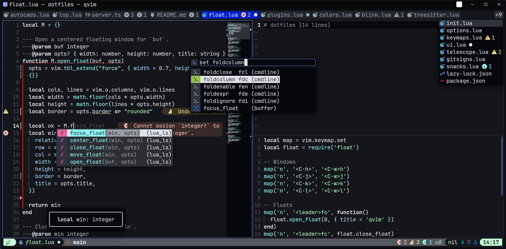 | 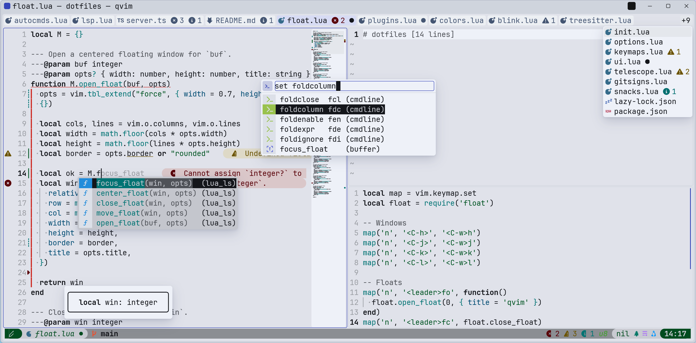 |

The editor is a pane on the window frame. Neovim splits are regions within that pane, not independently elevated
surfaces. Completion, command-line completion, hover, and tab overflow use the shared overlay rules.

| Area | dot binding |
|------|--------------|
| Caption and frame | Window title, native caption controls, and chat entry point share the frame |
| Completion and command line | Map Neovim-provided content to menu/overlay geometry without altering its cells |
| Cursor and content | The grid owns text, syntax, content selection, and cursor position/shape |
| Floats and hover | Content-owned borders remain inside the overlay's rounded host |
| Scrollbar and minimap | Both belong to the content view; the map is optional and stays opaque |
| Splits | Neutral region outlines distinguish splits; the active editor region gets the editing outline |
| Tabs and overflow | A selected view uses the selection tone; inactive labels remain muted |

Solid, Mica, and optional pane translucency follow
[DESIGN.md's material rules](DESIGN.md#5-translucency); they do not introduce alternate control colors.

## Desktop chat

| Dark reference | Light reference |
|----------------|-----------------|
| 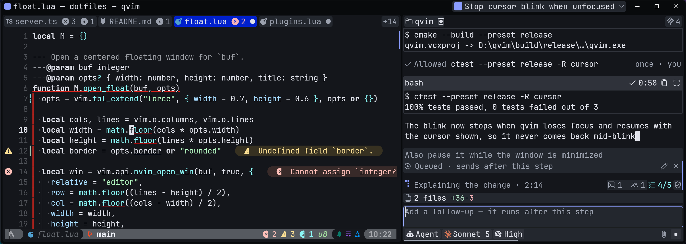 | 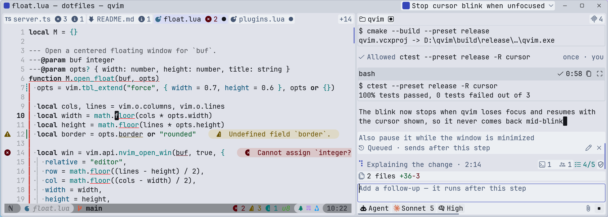 |

Chat is a peer pane beside the editor. The session title/switcher occupies the caption, while working directories and
session-service indicators occupy the chat's top band. The transcript, status, review summary, and composer remain
within the chat pane.

### A complete turn

| Dark reference | Light reference |
|----------------|-----------------|
| 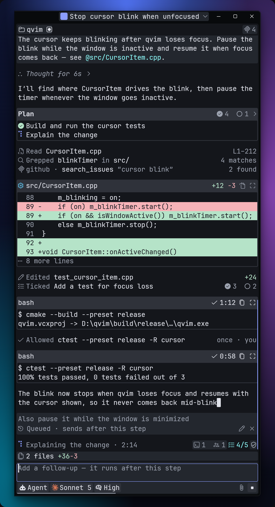 | 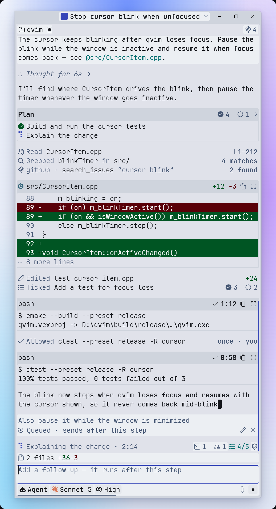 |

The transcript combines user-message surfaces, prose, folded thinking, tool rows, and cards.
The status row separates activity from plan progress and background work. The review summary reports changed files;
it does not become a second toolbar. The composer keeps mode, model, and effort together.

Represent each session state explicitly:

| State | Presentation | Dark reference | Light reference |
|-------|--------------|----------------|-----------------|
| Autopilot | Task objective, activity, and completion result | [View](images/chat_autopilot_dark.png) | [View](images/chat_autopilot_light.png) |
| Done | Finished reply and review summary | [View](images/chat_done_dark.png) | [View](images/chat_done_light.png) |
| Ended | Session overview with inactive input | [View](images/chat_ended_dark.png) | [View](images/chat_ended_light.png) |
| Needs you | Approval or question with available choices | [View](images/chat_needs_dark.png) | [View](images/chat_needs_light.png) |
| New session | Empty transcript and composer | [View](images/chat_fresh_dark.png) | [View](images/chat_fresh_light.png) |
| Plan mode | Proposed plan and the choice to start it | [View](images/chat_planmode_dark.png) | [View](images/chat_planmode_light.png) |
| Sessions | Session switcher identifying the selected session | [View](images/chat_sessions_dark.png) | [View](images/chat_sessions_light.png) |
| Working | Current activity, plan progress, and background work | [View](images/chat_working_dark.png) | [View](images/chat_working_light.png) |

### Component anatomy

**Diff card**

| Dark reference | Light reference |
|----------------|-----------------|
| 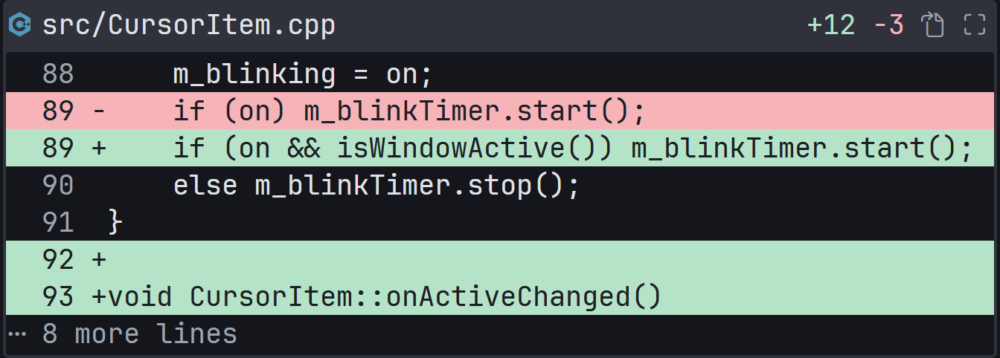 | 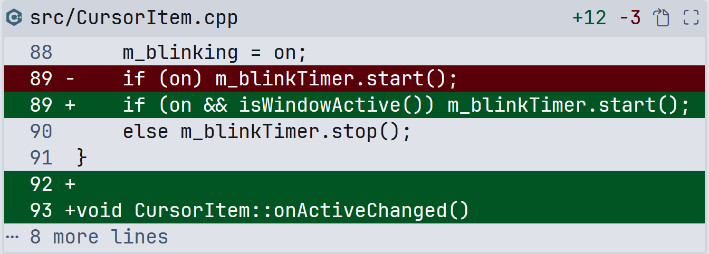 |

The heading identifies the file and exposes file actions. The inset body contains the diff; line fills and their text
pairing come from the [dot foreground pairings](#foreground-pairings).

**Approval**

| Dark reference | Light reference |
|----------------|-----------------|
| 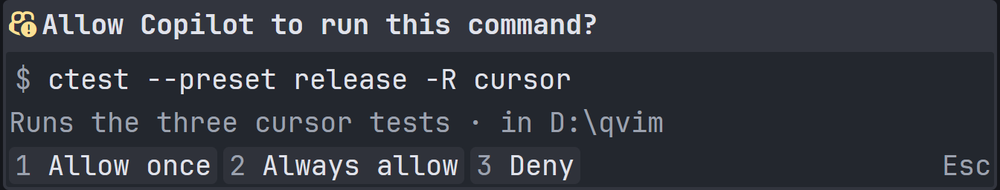 | 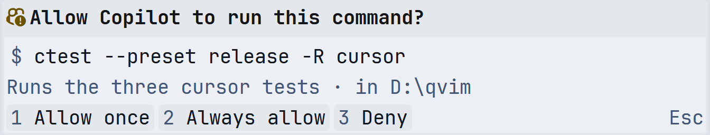 |

The request, explanation, and choices form one card. Status is not an action priority: action buttons retain their
neutral treatment. Questions and other requests use the same anatomy.

**Composer**

| Dark reference | Light reference |
|----------------|-----------------|
| 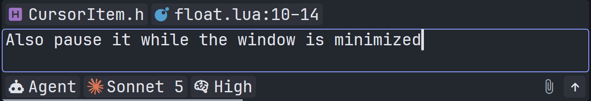 | 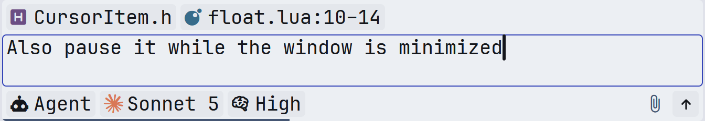 |

The editable input, rather than the whole composer or its selectors, owns the active editing outline.
Idle, working, queued, disabled, and open-menu states retain the shared component geometry.

**Reply table**

| Dark reference | Light reference |
|----------------|-----------------|
| 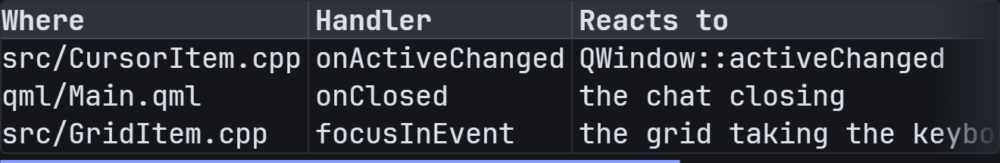 | 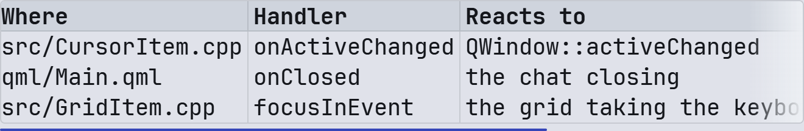 |

The table stands on the transcript without an extra card. Its header, column dividers, numeric alignment, and overflow
follow the [Table component](DESIGN.md#table).

### Remaining component states

| Family | Presentation |
|--------|--------------|
| Background activity, permissions, and plan progress | Separate indicators in the status row |
| Commands and output | Command card with state, copy action, and expandable output |
| Errors and limits | Explicit failure or actionable warning using the status treatment |
| Notices and turn boundaries | Quiet rows and dividers within the transcript |
| Plans | Plan card with completed, current, and pending steps |
| Review, scrolling, and jump-to-latest | Change summary, content scrollbar, and actionable hover |
| Session identity and switching | Title chip, working-directory band, and session menu |
| Sub-agents and handoffs | Named helper cards and handoff notices |
| Thinking and tool calls | Foldable muted thinking and tool rows with target/result metadata |
| User messages | Neutral message surfaces distinct from assistant prose |

## Android app

Android uses the same semantic component families on a touch-oriented, continuous pane. The system status/gesture areas
and Back behavior are platform bindings. Screen layout follows the Android touch profile, not the desktop cell grid.

### Home

| Dark reference | Light reference |
|----------------|-----------------|
| 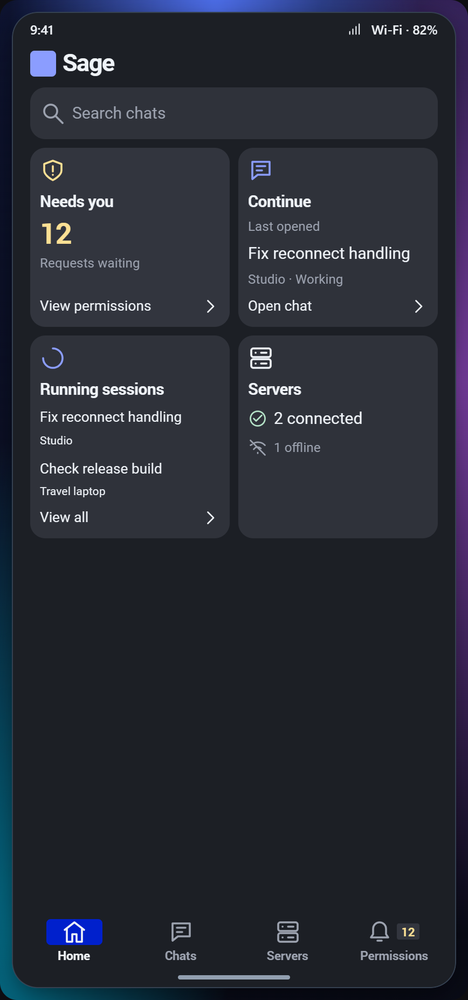 | 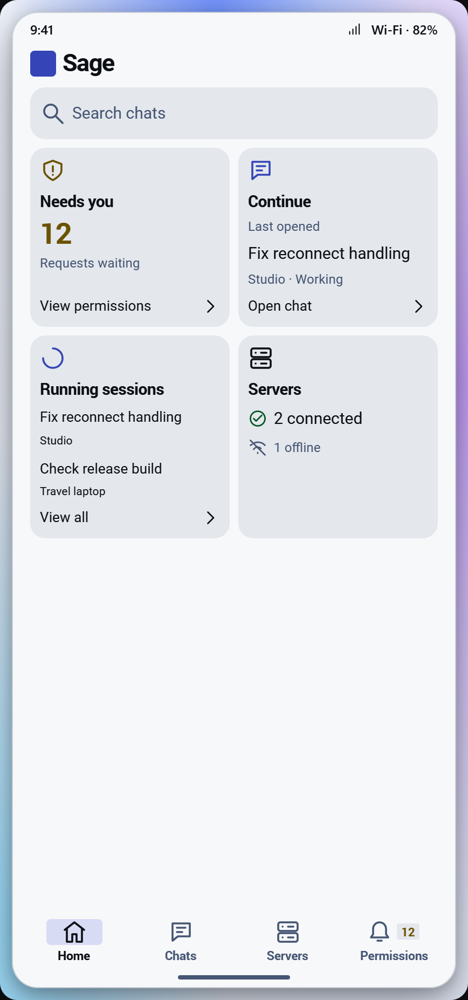 |

Home groups pending requests, the resumable chat, running sessions, and server availability into action tiles.

### Chats

| Dark reference | Light reference |
|----------------|-----------------|
| 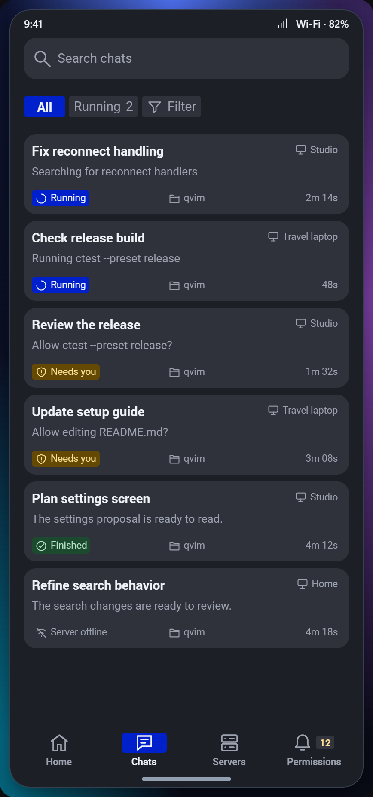 | 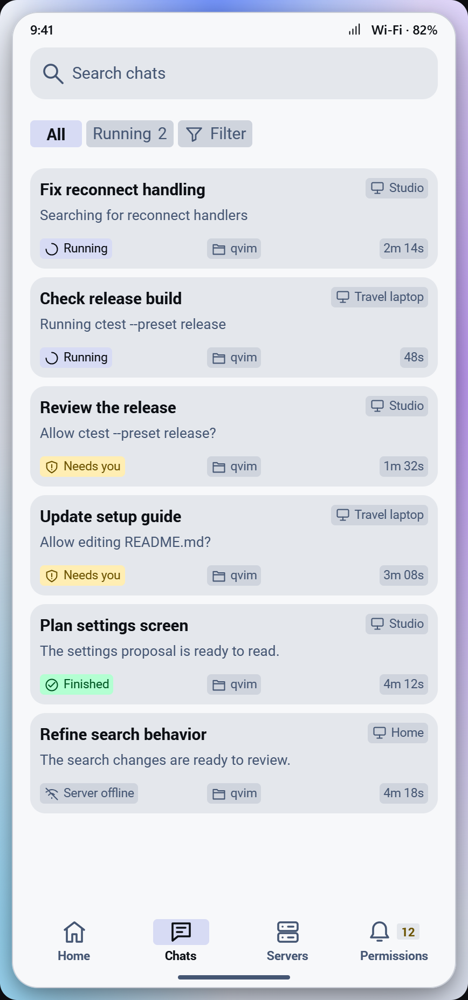 |

Search and filters precede the session list. Each row keeps its title, preview, host, state, directory, and elapsed
time together.

### Servers

| Dark reference | Light reference |
|----------------|-----------------|
| 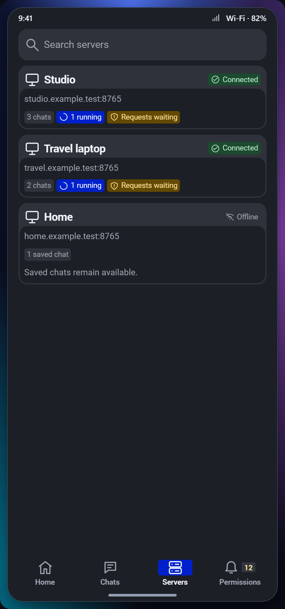 | 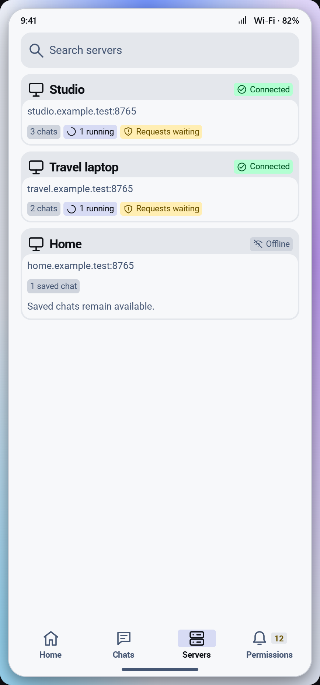 |

Each server card presents its identity, connection state, address, and available work. Offline state remains legible
without turning the whole card into a disabled surface.

### Permissions

| Dark reference | Light reference |
|----------------|-----------------|
| 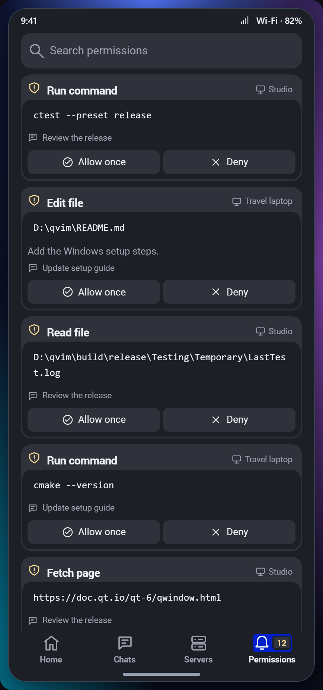 | 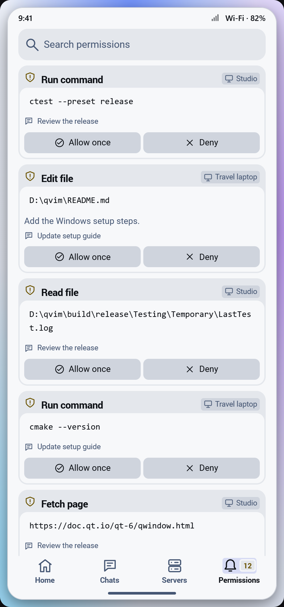 |

Requests retain their host and originating chat. The inset body contains the request details and actions; visual
button faces and their touch areas use the separate dimensions in the Android profile.

### Conversation

| Dark reference | Light reference |
|----------------|-----------------|
| 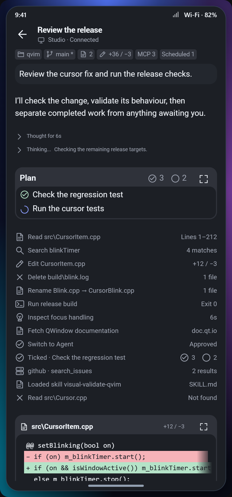 | 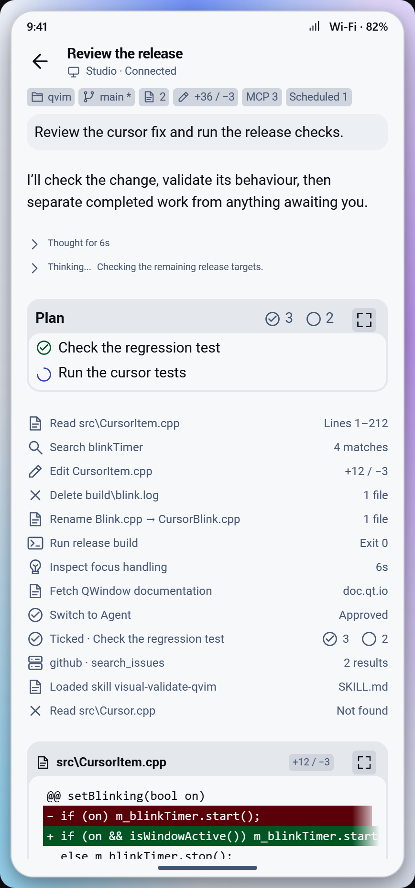 |

The heading identifies the session and host. Context badges carry directory, branch, changes, and services. The
conversation reuses thinking rows, tool results, plans, diffs, commands, tables, and requests rather than inventing
mobile-only meanings.

| Dark end-of-transcript reference | Light end-of-transcript reference |
|---------------------------------|----------------------------------|
| 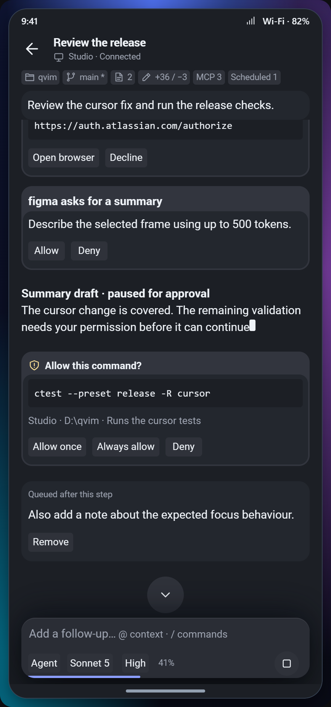 | 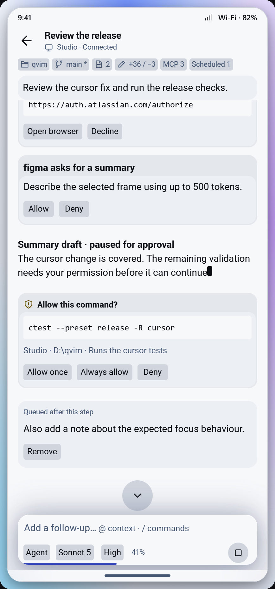 |

The composer groups mode, model, effort, context usage, and Send/Stop. Its elevated material and the text passing behind
it follow the Android composer profile. In light mode, a backdrop plane extends to the screen bottom;
it is part of the composer material, not a new content surface.

## Implementation mapping

Connect these component families to the existing native integration surfaces:

| Native integration surface | Reference responsibility |
|----------------------------|--------------------------|
| [Android UI](../../android/app/src/main/java/com/dot/companion/ui/ChatScreen.kt) | Touch-screen composition and conversation presentation |
| [ChatPanel.qml](../../desktop/qml/ChatPanel.qml) | Desktop chat pane, transcript, and composer |
| [Main.qml](../../desktop/qml/Main.qml), [WindowChrome.h](../../desktop/include/WindowChrome.h) | Window frame, caption integration, and editor/chat composition |
| [Shell.qml](../../desktop/qml/Shell.qml) | Grid host, cursor overlay, and focus ownership |

The native data flow and engineering invariants remain in [README.md](../../README.md#architecture) and
[AGENTS.md](../../AGENTS.md). Verify native behavior and both themes against the applicable rules before
claiming parity.
