# qvim application of Surfaces

This is the approved UI implementation target, not a claim that the native apps already implement it.
The screenshots are static design references, not native application captures. Identity squares and gradient preview
surrounds are presentation placeholders, not final product artwork or application surfaces.

[DESIGN.md](DESIGN.md) owns the rules, metrics, profiles, palette, and change-control policy.
This guide defines their qvim-specific composition and implementation mapping for both dark and light themes.
Use the canonical tokens rather than introducing component-specific values.

## Applicable rules

| Surface | Normative rules |
|---------|-----------------|
| Android app | [Android touch profile](DESIGN.md#101-android-touch-profile) and [qvim chrome profile](DESIGN.md#102-qvim-chrome-profile) |
| Desktop chat | [Shared metrics](DESIGN.md#4-metrics), [qvim chrome profile](DESIGN.md#102-qvim-chrome-profile), and [chat text alignment](DESIGN.md#103-qvim-desktop-chat-text-alignment) |
| Desktop editor | [Shared metrics](DESIGN.md#4-metrics), [component catalogue](DESIGN.md#9-components), and [qvim chrome profile](DESIGN.md#102-qvim-chrome-profile) |
| Palette and color pairing | [Canonical palette](DESIGN.md#11-qvim-reference-palette) |

## Desktop editor

| Dark reference | Light reference |
|----------------|-----------------|
| 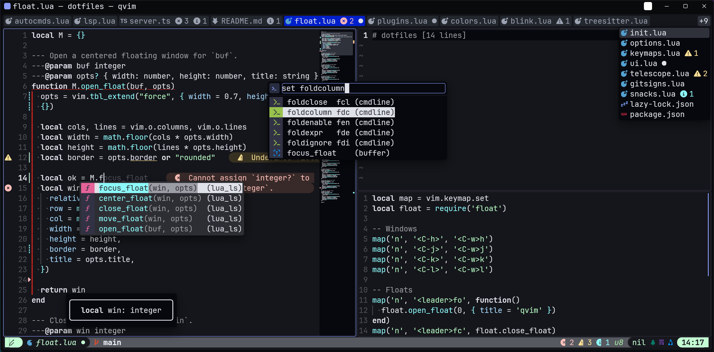 | 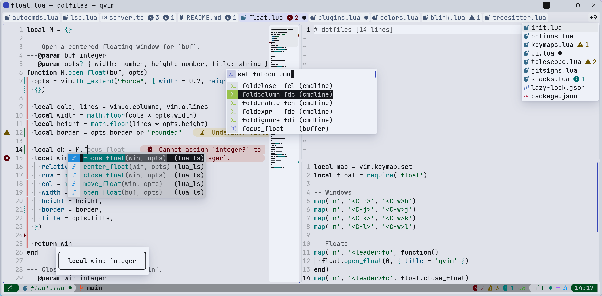 |

The editor is a pane on the window frame. Neovim splits are regions within that pane, not independently elevated
surfaces. Completion, command-line completion, hover, and tab overflow use the shared overlay rules.

| Area | qvim binding |
|------|--------------|
| Caption and frame | Window title, native caption controls, and chat entry point share the frame |
| Completion and command line | Map Neovim-provided content to menu/overlay geometry without altering its cells |
| Cursor and content | The grid owns text, syntax, content selection, and cursor position/shape |
| Floats and hover | Content-owned borders remain inside the overlay's rounded host |
| Scrollbar and minimap | Both belong to the content view; the map is optional and stays opaque |
| Splits | Neutral region outlines distinguish splits; the active editor region gets the editing outline |
| Tabs and overflow | A selected view uses the selection tone; inactive labels remain muted |

Solid, Mica, and optional pane translucency follow
[DESIGN.md's material rules](DESIGN.md#5-translucency); they do not introduce alternate control colors.

## Desktop chat

| Dark reference | Light reference |
|----------------|-----------------|
| 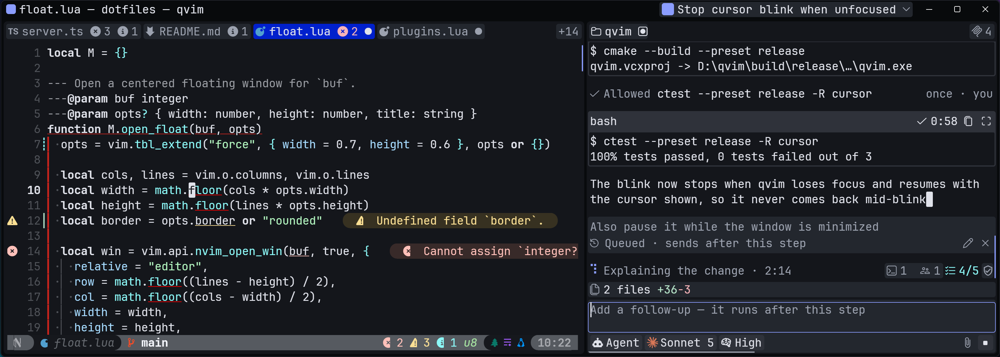 | 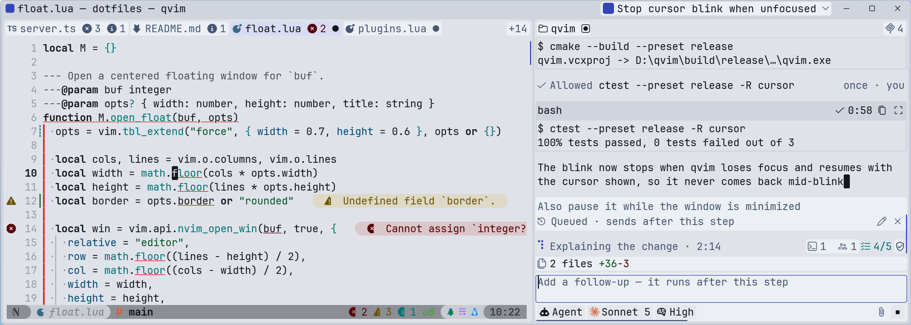 |

Chat is a peer pane beside the editor. The session title/switcher occupies the caption, while working directories and
session-service indicators occupy the chat's top band. The transcript, status, review summary, and composer remain
within the chat pane.

### A complete turn

| Dark reference | Light reference |
|----------------|-----------------|
| 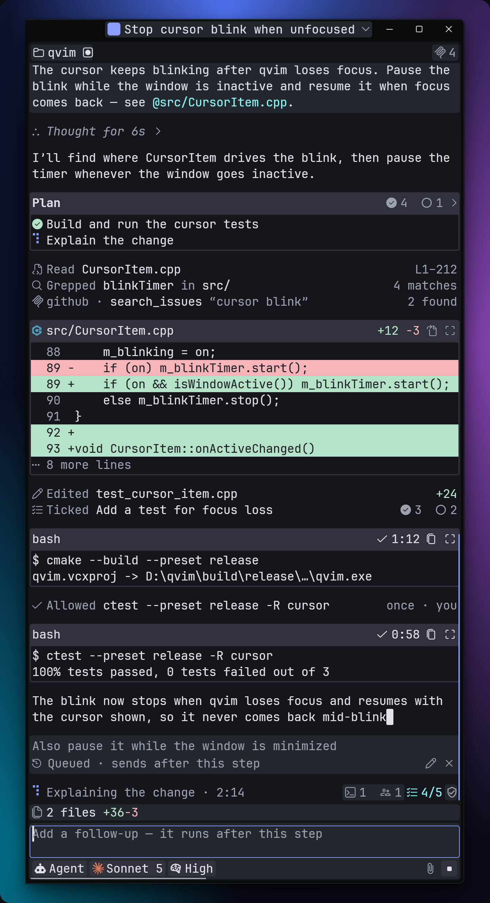 | 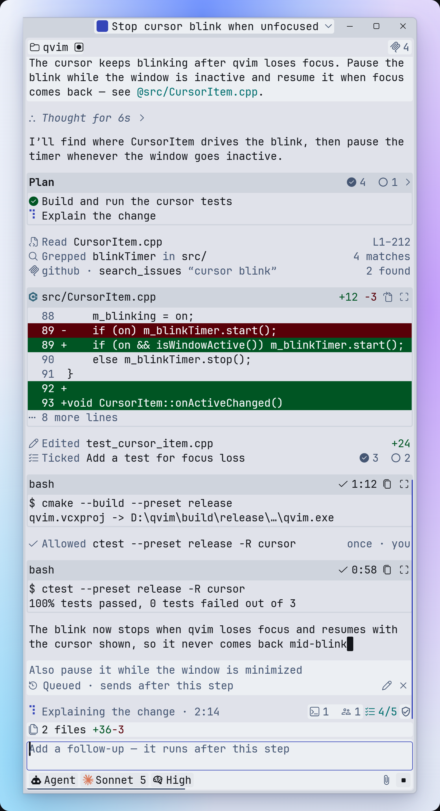 |

The transcript combines user-message surfaces, prose, folded thinking, tool rows, and cards.
The status row separates activity from plan progress and background work. The review summary reports changed files;
it does not become a second toolbar. The composer keeps mode, model, and effort together.

Represent each session state explicitly:

| State | Presentation | Dark reference | Light reference |
|-------|--------------|----------------|-----------------|
| Autopilot | Task objective, activity, and completion result | [View](images/chat_autopilot_dark.png) | [View](images/chat_autopilot_light.png) |
| Done | Finished reply and review summary | [View](images/chat_done_dark.png) | [View](images/chat_done_light.png) |
| Ended | Session overview with inactive input | [View](images/chat_ended_dark.png) | [View](images/chat_ended_light.png) |
| Needs you | Approval or question with available choices | [View](images/chat_needs_dark.png) | [View](images/chat_needs_light.png) |
| New session | Empty transcript and composer | [View](images/chat_fresh_dark.png) | [View](images/chat_fresh_light.png) |
| Plan mode | Proposed plan and the choice to start it | [View](images/chat_planmode_dark.png) | [View](images/chat_planmode_light.png) |
| Sessions | Session switcher identifying the selected session | [View](images/chat_sessions_dark.png) | [View](images/chat_sessions_light.png) |
| Working | Current activity, plan progress, and background work | [View](images/chat_working_dark.png) | [View](images/chat_working_light.png) |

### Component anatomy

**Diff card**

| Dark reference | Light reference |
|----------------|-----------------|
| 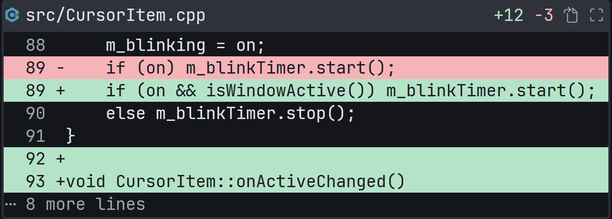 | 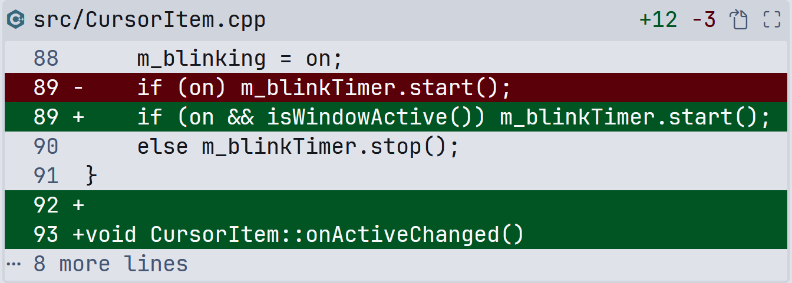 |

The heading identifies the file and exposes file actions. The inset body contains the diff; line fills and their text
pairing come from the [palette contract](DESIGN.md#113-foreground-pairings).

**Approval**

| Dark reference | Light reference |
|----------------|-----------------|
| 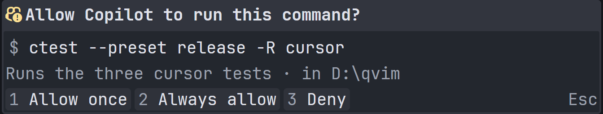 | 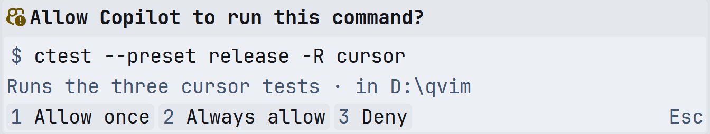 |

The request, explanation, and choices form one card. Status is not an action priority: action buttons retain their
neutral treatment. Questions and other requests use the same anatomy.

**Composer**

| Dark reference | Light reference |
|----------------|-----------------|
| 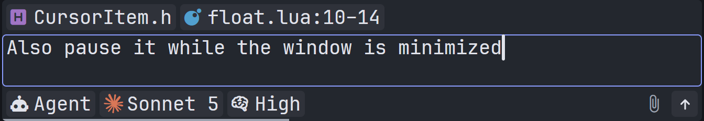 | 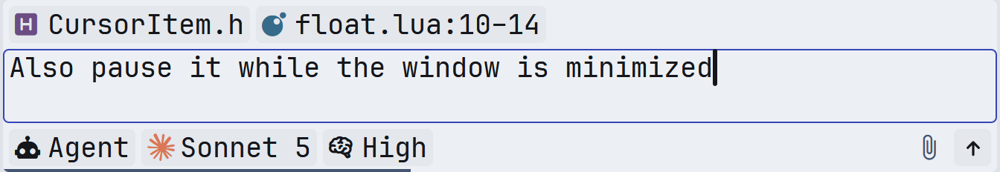 |

The editable input, rather than the whole composer or its selectors, owns the active editing outline.
Idle, working, queued, disabled, and open-menu states retain the shared component geometry.

**Reply table**

| Dark reference | Light reference |
|----------------|-----------------|
| 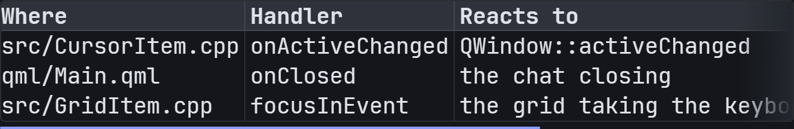 | 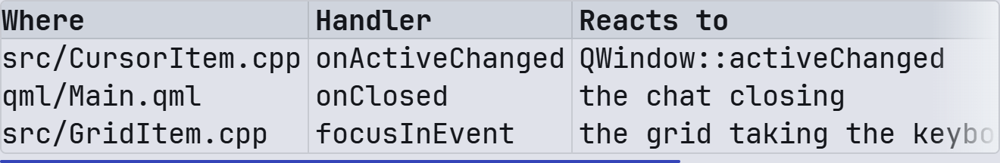 |

The table stands on the transcript without an extra card. Its header, column dividers, numeric alignment, and overflow
follow the [Table component](DESIGN.md#table).

### Remaining component states

| Family | Presentation |
|--------|--------------|
| Background activity, permissions, and plan progress | Separate indicators in the status row |
| Commands and output | Command card with state, copy action, and expandable output |
| Errors and limits | Explicit failure or actionable warning using the status treatment |
| Notices and turn boundaries | Quiet rows and dividers within the transcript |
| Plans | Plan card with completed, current, and pending steps |
| Review, scrolling, and jump-to-latest | Change summary, content scrollbar, and actionable hover |
| Session identity and switching | Title chip, working-directory band, and session menu |
| Sub-agents and handoffs | Named helper cards and handoff notices |
| Thinking and tool calls | Foldable muted thinking and tool rows with target/result metadata |
| User messages | Neutral message surfaces distinct from assistant prose |

## Android app

Android uses the same semantic component families on a touch-oriented, continuous pane. The system status/gesture areas
and Back behavior are platform bindings. Screen layout follows the Android touch profile, not the desktop cell grid.

### Home

| Dark reference | Light reference |
|----------------|-----------------|
| 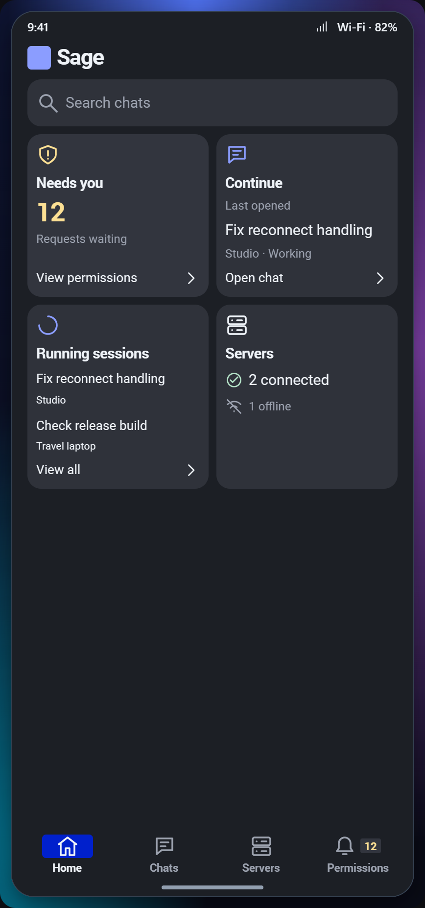 | 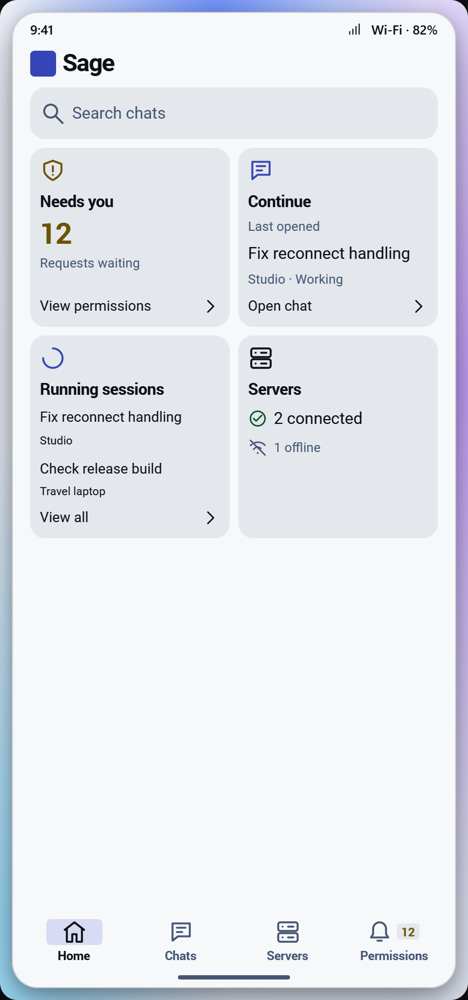 |

Home groups pending requests, the resumable chat, running sessions, and server availability into action tiles.

### Chats

| Dark reference | Light reference |
|----------------|-----------------|
| 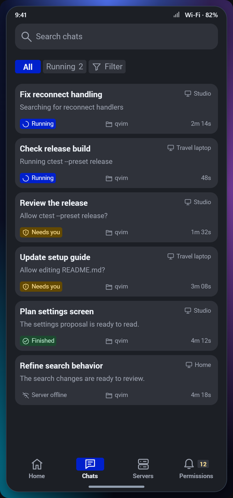 | 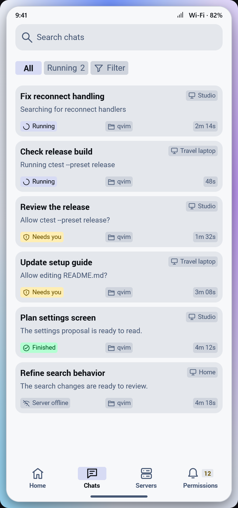 |

Search and filters precede the session list. Each row keeps its title, preview, host, state, directory, and elapsed
time together.

### Servers

| Dark reference | Light reference |
|----------------|-----------------|
| 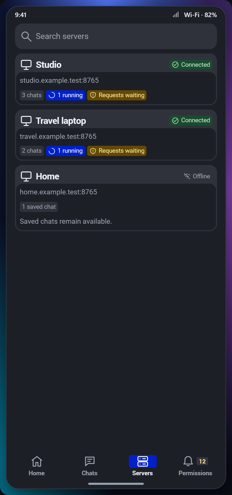 | 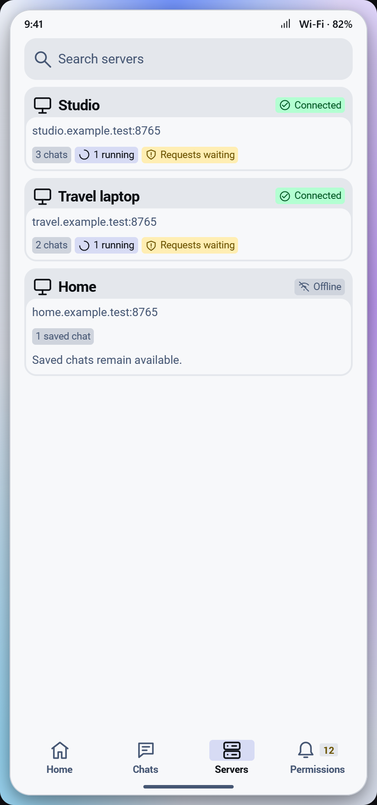 |

Each server card presents its identity, connection state, address, and available work. Offline state remains legible
without turning the whole card into a disabled surface.

### Permissions

| Dark reference | Light reference |
|----------------|-----------------|
| 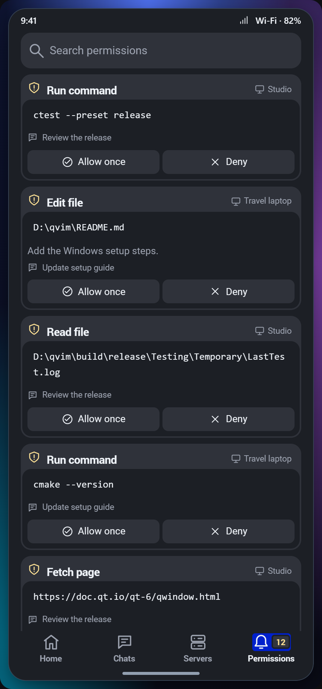 | 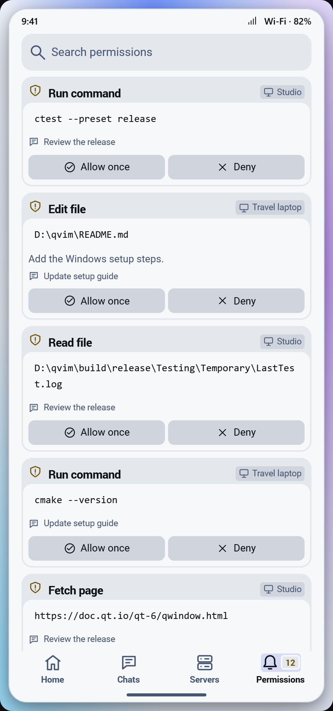 |

Requests retain their host and originating chat. The inset body contains the request details and actions; visual
button faces and their touch areas use the separate dimensions in the Android profile.

### Conversation

| Dark reference | Light reference |
|----------------|-----------------|
| 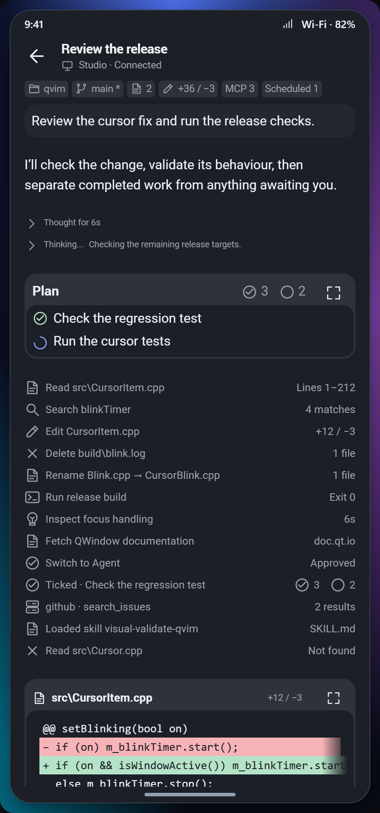 | 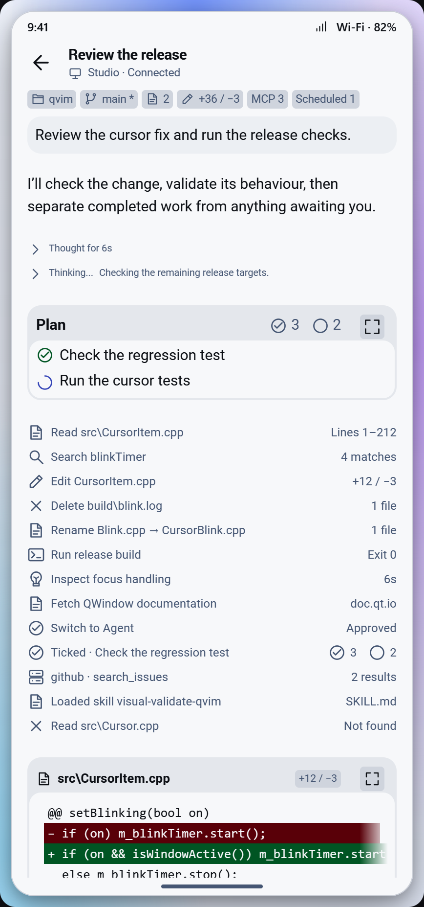 |

The heading identifies the session and host. Context badges carry directory, branch, changes, and services. The
conversation reuses thinking rows, tool results, plans, diffs, commands, tables, and requests rather than inventing
mobile-only meanings.

| Dark end-of-transcript reference | Light end-of-transcript reference |
|---------------------------------|----------------------------------|
| 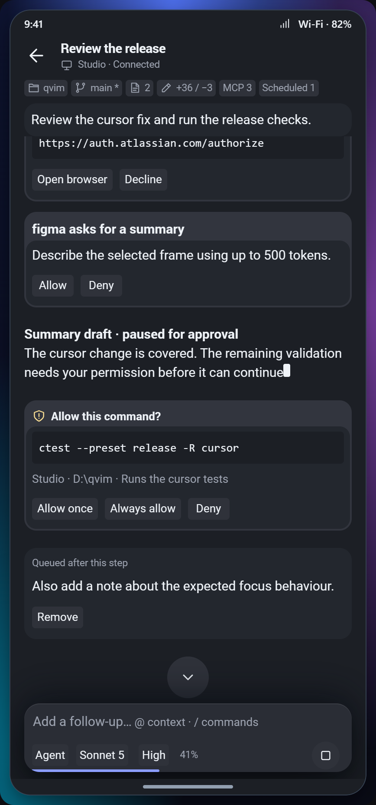 | 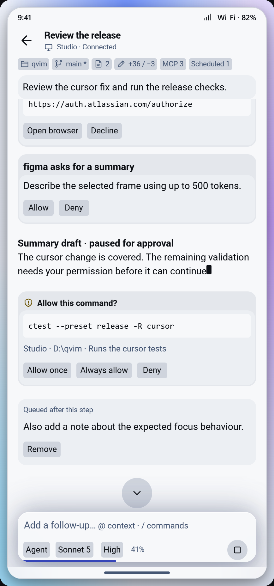 |

The composer groups mode, model, effort, context usage, and Send/Stop. Its elevated material and the text passing behind
it follow the Android composer profile. In light mode, a backdrop plane extends to the screen bottom;
it is part of the composer material, not a new content surface.

## Implementation mapping

Connect these component families to the existing native integration surfaces:

| Native integration surface | Reference responsibility |
|----------------------------|--------------------------|
| [Android UI](../../android/app/src/main/java/com/qvim/companion/ui/ChatScreen.kt) | Touch-screen composition and conversation presentation |
| [ChatPanel.qml](../../qml/ChatPanel.qml) | Desktop chat pane, transcript, and composer |
| [Main.qml](../../qml/Main.qml), [WindowChrome.h](../../include/WindowChrome.h) | Window frame, caption integration, and editor/chat composition |
| [Shell.qml](../../qml/Shell.qml) | Grid host, cursor overlay, and focus ownership |

The native data flow and engineering invariants remain in [README.md](../../README.md#architecture) and
[AGENTS.md](../../AGENTS.md). Verify native behavior and both themes against the applicable rules before
claiming parity.
